<div align="center">

# ServerWarden

**A calm, self-hosted control center for the handful of Linux servers you run at home.**

<sub>A Gefex project</sub>

Health, disks, containers, security posture and known vulnerabilities on one screen,
plus actions you approve with a hardware security key. Reachable only from your LAN or VPN.

[](LICENSE)


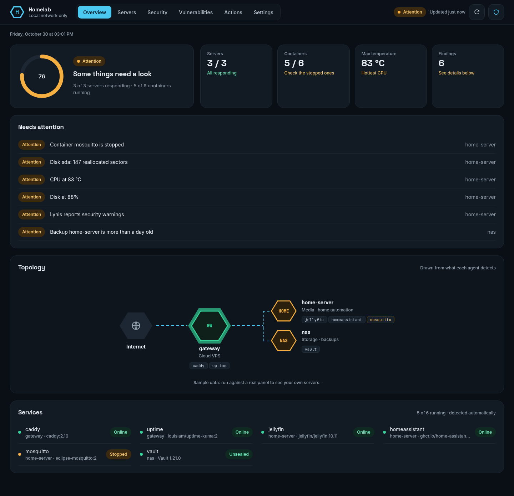

</div>

> **Status:** first public release. Feedback and issues are welcome.
> Every screenshot uses sample data.

---

## Why

Homelabs grow. One server becomes three: a VPS in front, a box for media, a NAS for
backups. Keeping an eye on them usually means a stack of tools (Prometheus, Grafana,
Uptime Kuma, a vulnerability scanner, SSH sessions…) that is bigger than the homelab.

serverwarden answers a few questions at a glance, without a database, without agents
listening on ports and without giving a web page the keys to your servers:

- **Is everything OK?** One health score, and a short list of what needs a look.
- **What is each server doing?** CPU, memory, disks and their S.M.A.R.T. health,
  temperatures, containers, pending reboots.
- **Am I exposed?** Hardening score, backups, SSH logins, CrowdSec alerts, changes to
  critical files, and known vulnerabilities in packages and container images.
- **Can I fix it from here?** Run the actions you allow, signed with your security key.

## Features

| | |
|---|---|
| **One-glance overview** | Health score, findings, an auto-drawn topology and every container, detected automatically. |
| **Servers** | Live CPU, memory and disk, S.M.A.R.T. (reallocated sectors, wear), temperatures, load, swap, battery, kernel. |
| **Security timeline** | The last 24 hours on one line: CrowdSec alerts per hour, hardware-key logins, backups, Lynis audits. |
| **Vulnerabilities** | Daily [Trivy](https://trivy.dev) scan of system packages and container images, shown as a heat map. |
| **Actions** | Each server declares its safe actions; running one needs your passkey, and the *server* verifies it. |
| **Your own commands** | Any command you want, on the servers you choose, with its output. Opt-in per server. |
| **Notifications** | Discord, Telegram, ntfy, Slack, Gotify, email and webhooks, with pending, repeat and resolved alerts. |
| **First-run wizard** | Language, address, allowed networks, certificate and account in four steps. |
| **Made for phones too** | Every page works on a phone; English and Spanish included. |

## A tour

<table>
<tr>
<td width="50%">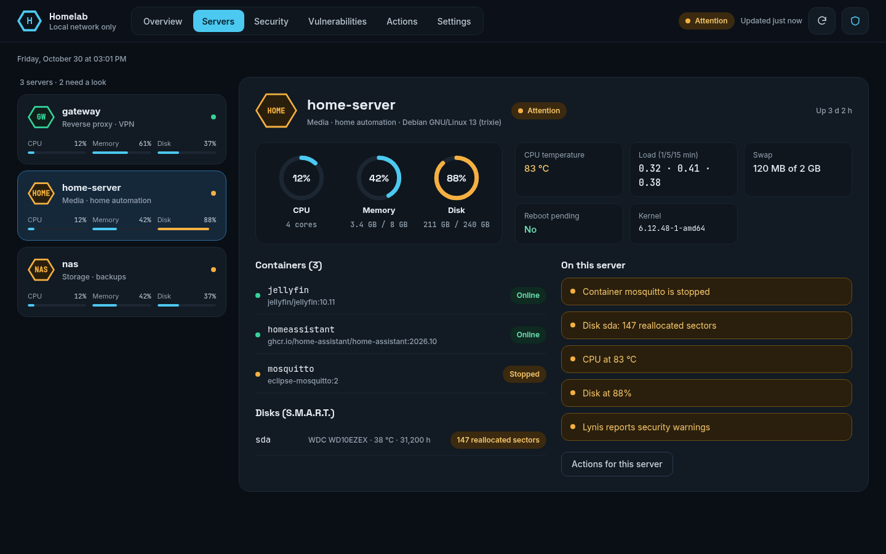<br><b>Servers.</b> Pick one on the left, see everything about it on the right.</td>
<td width="50%">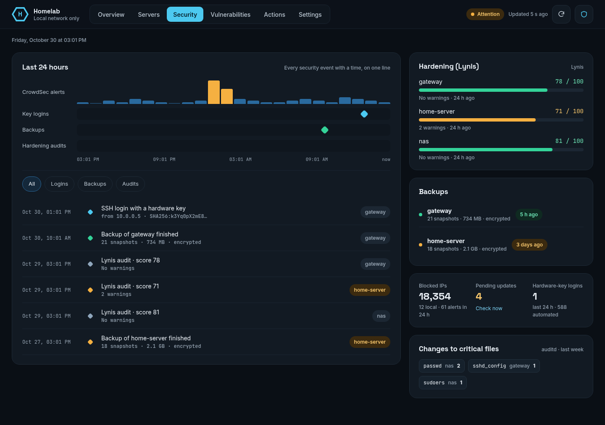<br><b>Security.</b> A day of events on one line, hardening and backups beside it.</td>
</tr>
<tr>
<td>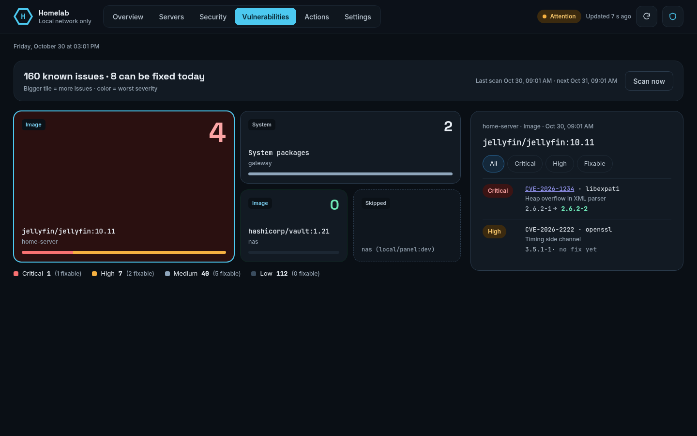<br><b>Vulnerabilities.</b> Bigger tile, more issues; the color is the worst severity.</td>
<td>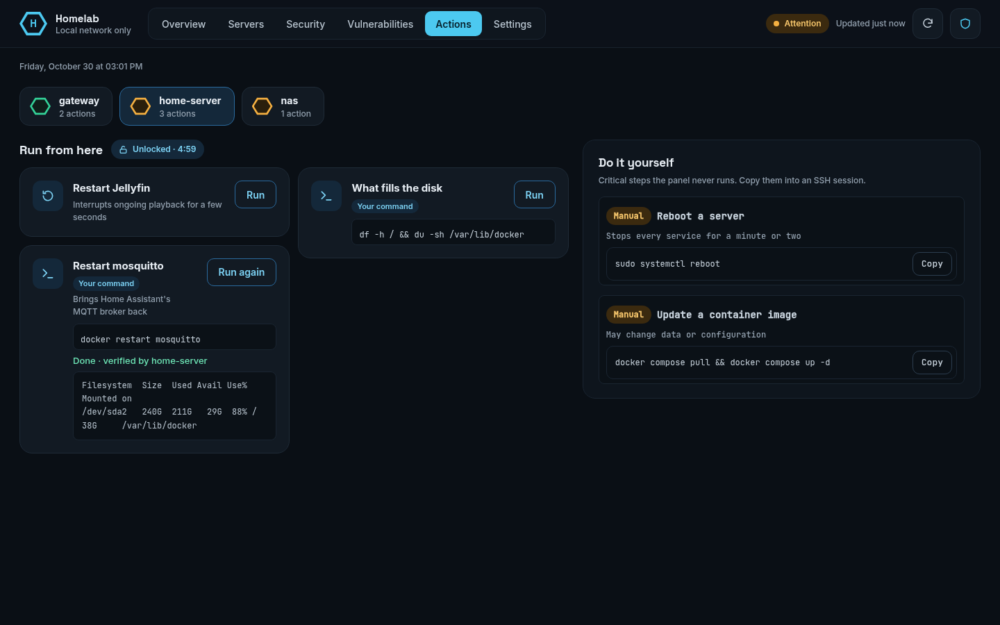<br><b>Actions.</b> Pick a server, run what it allows and read the output.</td>
</tr>
<tr>
<td>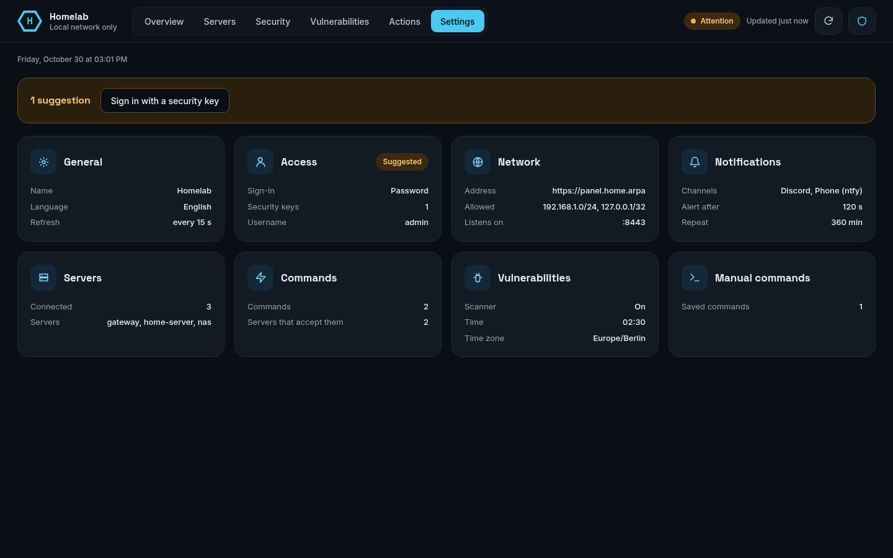<br><b>Settings.</b> A summary per area; open one and only that one stays on screen.</td>
<td>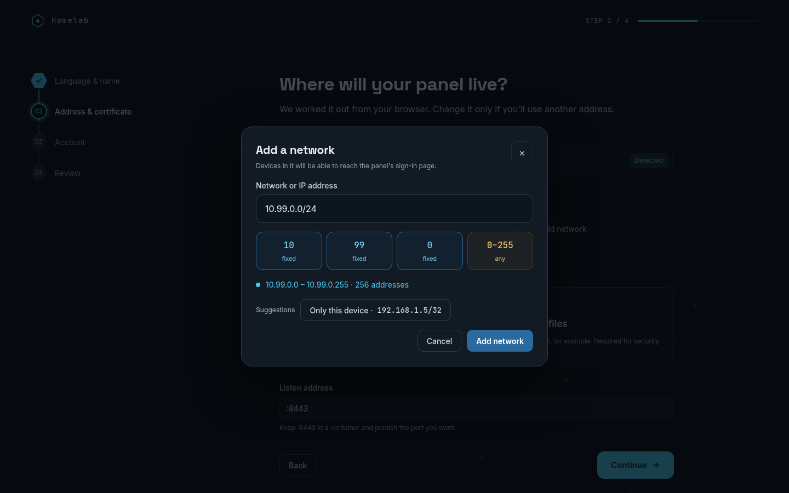<br><b>Setup.</b> The wizard explains every network you allow and won't let you lock yourself out.</td>
</tr>
</table>

<p align="center">
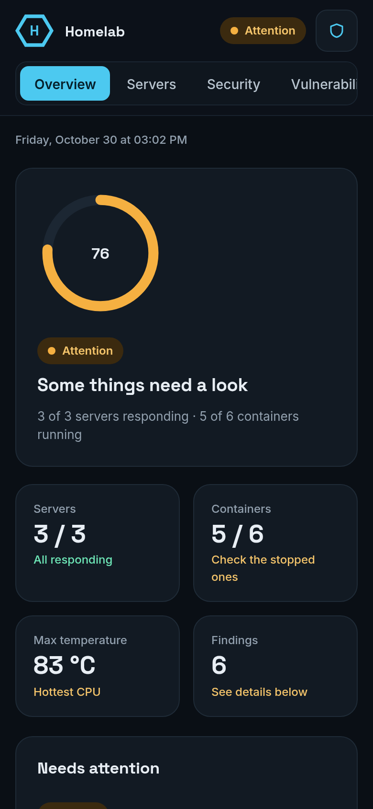
&nbsp;&nbsp;
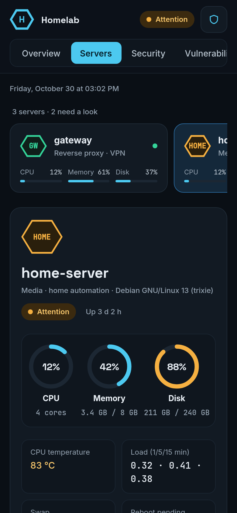
</p>

## How it works

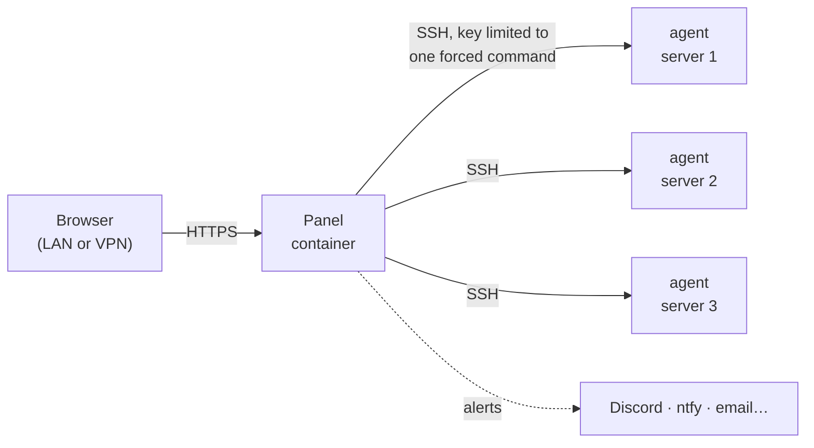

- **The agent** is one static binary per server (amd64, arm64, armv7). It opens no
  ports and has no daemon: the panel runs it over SSH, and the SSH key can only run
  that binary (`restrict,command=` in `authorized_keys`). It reads `/proc`, `/sys`,
  Docker and the tools it finds: `smartctl`, `restic`, CrowdSec's `cscli`, `lynis`,
  `aureport`, and the package manager (`apt-get`, `dnf`, `checkupdates`, `apk`).
- **The panel** polls the agents over one persistent SSH connection per server,
  judges their health, keeps the history it needs in memory and serves the UI. Its
  settings are a JSON file in its data directory, edited from the UI.
- **Nothing else.** No database, no message queue, no agent listening on the network.

### Security model

| | |
|---|---|
| **Who can open it** | Only the networks you list (e.g. your LAN and your VPN). Everyone else gets nothing. |
| **Signing in** | A hardware security key (passkey with PIN), or a password (Argon2id) with optional two-step verification (TOTP, any authenticator app, plus single-use recovery codes). Security keys need the panel to be opened by a domain name with a valid certificate; with an IP address you use a password. |
| **Changing settings** | Locked by default. Unlocking asks for your key, or your password and code, again and lasts 5 minutes. |
| **Actions** | Declared by each server in its root-owned `agent.json`; the panel cannot add any. With passkeys, every run is signed for *that* action on *that* server, valid once and for 2 minutes, and the server verifies the signature itself: a compromised panel is not enough. |
| **Your commands** | Off unless a server sets `"panel_commands": true`. Then whoever controls the panel can run anything there; with passkeys the signature covers the exact command text, so the panel cannot show you one command and run another. |
| **Image export** | Off unless a server sets `"image_export": true`. Then the panel may copy the images of *running* containers (nothing else) to scan them; the copy is deleted after the scan. |
| **Server identity** | You confirm each server's SSH fingerprint before it is saved; a changed host key is refused. |
| **Installing agents** | The install script downloads the agent from the panel with the panel's certificate pinned and checks its SHA-256. |
| **Secrets at rest** | Nothing secret is stored in plain text. Notification tokens, the generated TLS key and the TOTP data are sealed with AES-256-GCM under a key kept in its own file (`secret.key`, or a Docker/Podman secret); the panel's SSH keys use OpenSSH's own passphrase encryption. The TOTP secret is also sealed with a key derived from your password, and recovery codes are stored as HMACs. |
| **Secrets in transit** | No endpoint returns a stored secret: the UI gets them masked, errors and logs redact them, and API answers are never cached. The TOTP secret is sent once, while you enable it; the QR code is drawn by the panel itself. |

## Quick start

You need a Linux machine with Docker or Podman for the panel (amd64, arm64 or armv7: a
mini PC, a NAS or a Raspberry Pi), and SSH access as root to each server you add.

**1. Write a `compose.yaml`** (a complete one is in [`examples/homelab`](examples/homelab/compose.yaml)):

```yaml
services:
  serverwarden:
    image: pedro00100/serverwarden:0.7      # or ghcr.io/pedro00100/serverwarden:0.7
    restart: unless-stopped
    read_only: true
    cap_drop: [ALL]
    security_opt: [no-new-privileges:true]
    tmpfs: [/tmp]
    volumes:
      - data:/var/lib/serverwarden
    ports:
      - "192.168.1.10:8443:8443"            # your LAN address, never 0.0.0.0 on a public host
    mem_limit: 768m
    pids_limit: 128
volumes:
  data:
```

**2. Start it** and open the one-time link it prints:

```sh
docker compose up -d
docker compose logs serverwarden    # https://<address>:8443/#setup=…
```

The image is signed. To check it before running it (with [cosign](https://docs.sigstore.dev)):

```sh
cosign verify pedro00100/serverwarden:0.7 \
  --certificate-identity-regexp '^https://github.com/pedro00100/serverwarden/' \
  --certificate-oidc-issuer https://token.actions.githubusercontent.com
```

**3. Follow the wizard.** Language and name, the address you will use,
the networks allowed to open the panel, the certificate (generate one or bring your own)
and your account.

<p align="center">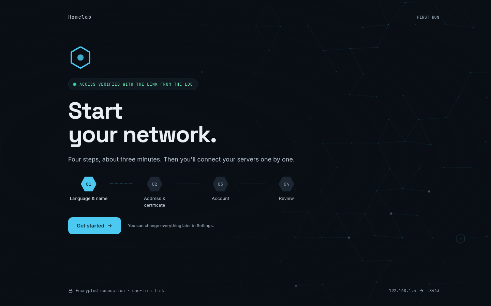</p>

**4. Add your servers.** *Settings › Servers › Add server*:

1. Name it and give its SSH address. The panel shows the server's fingerprint;
   check it on the server with `ssh-keygen -lf /etc/ssh/ssh_host_ed25519_key.pub`.
2. Generate the install script and run it **as root on that server**. It installs the
   agent in `/usr/local/bin`, writes `/etc/serverwarden/agent.json` and adds the panel's
   two restricted keys to `authorized_keys`. Running it again changes nothing.
3. Press *Test connection*. The server shows up on the overview within seconds.

**5. Optional.** Register a security key in *Settings › Access* (needs a domain and a
valid certificate), add notification channels, turn on vulnerability scans.

## Configuration

### The panel

Everything is editable from *Settings*, and stored in `/var/lib/serverwarden/settings.json`
(a backup of the previous version is kept next to it). To start from a file instead of the
wizard, import it once:

```sh
docker compose run --rm panel -import /var/lib/serverwarden/my-settings.json
```

| Section | What it holds |
|---|---|
| `general` | Title, language, polling interval. |
| `web` | Listen address, public origin, certificate, allowed networks. |
| `access` | `passkey` or `password`, username. Two-step verification is turned on in *Settings › Access* and kept apart, in `totp.json`. |
| `notifications` | Alert policy (wait before alerting, repeat, notify when resolved) and channels. |
| `servers` | Each server's id, name, role, position (`edge` faces the internet) and SSH address. |
| `commands` | Your own commands and the servers they may run on. |
| `manual_actions` | Critical steps the panel only shows, with the command to copy. |
| `scanner` | Daily vulnerability scan: on/off, time, time zone, skip images. |

Secret values in the file (webhook URLs, tokens, passwords of notification channels) are
sealed (`"enc:v1:…"`), so `settings.json` can be read, copied or shown without exposing
them. An imported file may hold them in plain text: they are sealed on import, so delete
that file afterwards.

**The secret key.** On first start the panel creates `secret.key` (32 random bytes) in its
data directory. Without it the sealed values cannot be read: keep it in your backups, and
preferably apart from them. To keep it out of the data directory, give the panel a
Docker or Podman secret:

```yaml
services:
  panel:
    command: ["-secret-key", "/run/secrets/panel_key"]
    secrets: [panel_key]
secrets:
  panel_key:
    file: ./panel.key   # head -c 32 /dev/urandom | base64 > panel.key; chmod 600 panel.key; sudo chown 10001 panel.key
```

If the key is lost or replaced, the panel still starts: it logs which secrets could not be
opened and you enter them again in *Settings*. Two-step verification then has to be set up
again (`-reset-password` turns it off).

### Each server: `/etc/serverwarden/agent.json`

Owned by root, mode 0600. It decides what the panel may trigger on that server.

```json
{
  "server": "atlas",
  "action_auth": "passkey",
  "panel_commands": true,
  "image_export": true,
  "actions": {
    "restart-jellyfin": {
      "name": "Restart Jellyfin",
      "description": "Interrupts ongoing playback for a few seconds",
      "command": ["/usr/bin/docker", "restart", "jellyfin"]
    }
  },
  "backups": [
    { "name": "atlas", "repository": "/srv/backups/atlas", "password_file": "/root/.restic/atlas" }
  ],
  "notify": ["/usr/bin/curl", "-fsS", "-d", "{level}: {text}", "https://ntfy.sh/my-topic"]
}
```

| Field | Meaning |
|---|---|
| `action_auth` | `passkey` (default): every action needs a signature this server verifies. `ssh-key`: the action key alone is enough, for panels that use password access. |
| `panel_commands` | Accept the commands defined in *Settings › Commands*. Off by default. Commands are shown in the UI and in notifications: never write a password in one; read it from a file on the server instead. |
| `image_export` | Let the panel copy images built on this server to scan them (see below). Off by default. |
| `actions` | Safe actions the panel may run here. Commands run without a shell and start with an absolute path. |
| `backups` | restic repositories whose snapshots show up in *Security*. |
| `notify` | A command run on every action attempt, accepted or not; `{level}` and `{text}` are replaced. |

### A complete example

[`examples/homelab`](examples/homelab) is a full, fictional setup: a VPS in front and two
servers at home, with the panel on the NAS. It has the `settings.json`, the
`compose.yaml` and one `agent.json` per server, and shows when to accept panel commands
and when not to.

## Day-to-day

- **Updating.** `docker compose pull && docker compose up -d`. Tags follow semantic
  versioning: `0.7` gets every fix of 0.7.x, `latest` everything. Settings migrate on
  their own (a copy of the previous ones is kept). If a release note says the agent
  changed, run each server's install script again (*Settings › Servers*); it is safe to
  repeat. The panel never pushes binaries to your servers by itself: a compromised
  panel must not be able to replace the agent everywhere.
- **Notifications.** Health alerts fire after a problem lasts a while (2 minutes by
  default), repeat if it goes on and tell you when it is resolved. Each channel picks a
  minimum level and the kinds of events it wants, and can use its own message template.
- **Vulnerability scans.** Trivy is downloaded the first time scans are turned on (its
  checksum is pinned) and runs once a day, once at least one server answers. It scans
  each server's system packages and the image of every running container, exactly the
  one in use: images pulled from a registry are fetched by digest; images built on the
  server are only in its local Docker, so they are copied over SSH if that server sets
  `"image_export": true`, and listed as skipped otherwise. A server that cannot be reached
  keeps its previous results. The panel needs internet access, a few hundred MB of memory
  and, while scanning a copied image, as much free disk as the image takes.
- **Lost access?** If the settings cannot be loaded, the panel serves a recovery page;
  the link is printed in its log. From the host you can also:

  ```sh
  docker compose exec panel serverwarden -new-enrollment    # one-time link to register a key
  docker compose exec -T panel serverwarden -reset-password < new-password.txt   # also turns two-step verification off
  ```
- **Lost your phone?** Sign in with one of the recovery codes, then turn two-step
  verification off and on again in *Settings › Access* to move it to the new phone.

## Security: what the panel covers and what you do

The panel is responsible for what it controls: its web interface and API, the data it
stores, the agent and the way they talk. The machines it runs on are yours to protect.
See [SECURITY.md](SECURITY.md) for the details and how to report a vulnerability.

| The panel takes care of | You take care of |
|---|---|
| Sign-in (passkeys, Argon2id passwords, TOTP), sessions, rate limits, CSRF and origin checks | Keeping the host OS, Docker/Podman and the panel image up to date |
| Who can open it (allowed networks) and HTTPS with modern TLS only | The firewall and network: do not publish the panel to the internet; reach it over LAN or VPN |
| Sealing every stored secret, masking and redacting them everywhere | Who has root or physical access to the host: root can read anything, including `secret.key` |
| Restricted SSH keys (forced command, `from=`), pinned host keys, signed actions verified by each server | What each server allows in its `agent.json` (`panel_commands`, `image_export`, actions) |
| Verified downloads of the agent and of Trivy (pinned certificate and checksums) | Backups of the data directory and of `secret.key`, and where those backups are kept |
| Not running as root in its container, read-only filesystem, no capabilities | Running the container with those restrictions, as in the example compose file |

## Development

Nothing to install except Podman or Docker: Go and Node run in throwaway containers.

```sh
make dev            # the UI with sample data at http://localhost:5173 (MOCK_SCREEN=setup for the wizard)
make test           # Go tests
make smoke          # end-to-end test of the panel binary with a real sshd
make ui-check       # with make dev running: every page in headless Chromium, fails on JS errors
make install-e2e    # the real image, a Debian server and Chromium: add the server from the UI and install its agent
make screenshots    # with make dev running in English: the images in this README
make image          # the container image
make clean-all      # remove build output, caches and images
```

```
cmd/panel, cmd/agent     entry points
internal/
  domain/                model and health rules, no dependencies
  ports/                 interfaces the core needs
  app/                   use cases: monitor, auth, actions, settings, vulnerabilities
  adapters/              SSH, web, passkeys, Trivy, notifications, install script
  agent/                 what the agent collects and runs
  config/                panel settings and their validation
  brand/                 product name and paths (rename here)
web/src/lib/
  core/                  API, state and derived data; no markup
  i18n/                  translations (English base) and formatting
  theme/                 design tokens
  ui/                    components
examples/homelab/        a complete, fictional configuration
```

**Translations.** Copy `web/src/lib/i18n/en.js` to `<lang>.js`, translate it and list it
in `web/src/lib/i18n/index.svelte.js`; notification texts live in `internal/i18n`.
Missing keys fall back to English.

## License

Copyright © 2026 Gefex. Licensed under the [AGPL-3.0](LICENSE): if you run a modified
version for others, share your changes.
